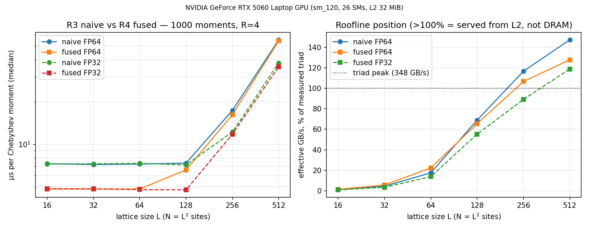

# A sparse physics workload as a GPU memory-hierarchy probe

*Technical report, 2026-10-17.*

This report uses a verified tight-binding/KPM workload to study the relationship
between algorithmic memory traffic and measured GPU time. It covers naive and
fused CUDA kernels, a HIP compile check, a local Radeon runtime investigation,
and two related comparisons: TIM conductivity in a 2D thermal solver and the
documented CUDA-to-MUSA migration mechanisms.

## 1. Model and implementations

The physical model is an open-boundary square lattice with nearest-neighbor
hopping. In CSR form, the Hamiltonian has `4L(L-1)` nonzeros for an `L×L`
lattice. The Kernel Polynomial Method estimates the density of states from
Chebyshev moments. With the spectrum rescaled to `[-1,1]`, the recurrence is

```text
t0 = r
t1 = H' r
t(n+1) = 2 H' t(n) - t(n-1)
mu_n = <r|t(n)>
```

The implementation uses 1000 moments and Jackson damping. Exact diagonalization
for L=8..14 and a stochastic CPU KPM run with R=32 provide the numerical
references. The GPU timing sweep uses R=4 in both modes.

The naive GPU path separates SpMV from the recurrence update. The fused path
keeps each row's SpMV result in a register and applies the recurrence in the same
kernel. The central operation is a sparse stencil-like operator followed by
vector operations, so memory movement and launch overhead matter more than dense
floating-point throughput. Eigen is used only for exact diagonalization on the
host.

## 2. Numerical verification

| Layer | Check | Result |
|---|---|---|
| Exact diagonalization | Trace, bipartite symmetry, analytic minimum eigenvalue | Trace and symmetry near machine precision; L=14 minimum-eigenvalue error `4.1e-14` |
| CPU KPM | DOS normalization and exact-diagonalization histogram | Integral error `3.9e-7`; matched-histogram L1 distance `0.1953` within the stochastic-noise bound |
| Naive/fused GPU | Same seed and recurrence as the CPU implementation | FP64 moments agree to `1.1e-16` at L=14 and `3.3e-16` at multi-block L=17; benchmark-class grids L=128/L=256 agree to `6.6e-14` at reduced moment counts; FP32 moments are within `1.9e-6` of the FP64 reference |
| HIP compile | Hipified kernels with `hipcc 7.1.1`, `gfx942` | Clean compile; runtime results are discussed separately below |

The tolerances and negative-result rules are in [`README.md`](../README.md) and
[`docs/KPM.md`](KPM.md). CTest passes 2/2, including a regression test for the
traffic coefficients.

## 3. Analytic memory traffic

Let `rb` be the real-number width in bytes and `n=L²`. Including the CSR matrix
and the per-moment dot product, the analytic global-memory traffic per random
vector is

```text
naive = matrix + 7 rb n
fused = matrix + 5 rb n
```

For FP64, these expressions are `matrix + 56n` and `matrix + 40n`. Fusion removes
the write/read round trip of the intermediate SpMV result `w`. The naive
recurrence reads `w` and `t(n-1)`; it does not reread `t(n)`.

The corresponding naive-to-fused ratios are 1.40 for vector traffic alone and
1.17 when the FP64 CSR matrix is included (`108n/92n` in the square-lattice
approximation used here). The dot reduction is present in both modes and is
included in the timings and byte counts. These totals count algorithmic bytes;
they do not identify which memory level serves the traffic.

## 4. NVIDIA measurements

The test machine has an NVIDIA GeForce RTX 5060 Laptop GPU (`sm_120`, 26 SMs,
32 MiB L2). The sweep uses 1000 moments, R=4, device-side timing, and 11
repetitions per point. The measured STREAM-like FP64 triad baseline is
347.9 GB/s, median [346.9, 348.8] over 20 repetitions.

Two reporting defects were found during preparation of this report: min/max was
read after sorting the timing vector, and an earlier naive-traffic expression
charged for a nonexistent `t(n)` read. Both are fixed in the source. The values
below come from the 2026-10-18 JSON, which also records per-repetition raw
timings and device/driver/seed/toolchain metadata.

FP64 microseconds per Chebyshev moment, median [min,max]:

| L | N | naive | fused | naive/fused median-time ratio |
|--:|--:|--:|--:|--:|
| 16 | 256 | 7.28 [7.10, 7.74] | 4.82 [4.78, 4.84] | 1.51x |
| 32 | 1024 | 7.19 [7.10, 7.25] | 4.81 [4.80, 5.01] | 1.49x |
| 64 | 4096 | 7.24 [7.18, 7.26] | 4.82 [4.80, 4.85] | 1.50x |
| 128 | 16384 | 7.35 [7.34, 7.44] | 6.58 [6.58, 6.58] | 1.12x |
| 256 | 65536 | 17.39 [17.38, 17.40] | 16.21 [16.21, 17.06] | 1.07x |
| 512 | 262144 | 55.15 [55.14, 55.17] | 54.14 [54.05, 54.19] | 1.02x |

Brackets contain the per-mode minimum and maximum across 11 repetitions, not
confidence intervals. The ratio is computed from the two medians. Complete
FP32/FP64 data are in [`data/kpm_gpu_bench.json`](../data/kpm_gpu_bench.json).



At L=512, fused FP32 takes 35.44 [35.44, 35.45] microseconds, compared with
54.14 [54.05, 54.19] for FP64. The ratio is 1.53 rather than the factor of two
suggested by byte width alone.

### Launch and latency effects

For L=16..64, the naive path has three launches per moment (SpMV, recurrence,
and dot), while the fused path has two. Both paths operate on a
several-microsecond latency floor. The small-size gains are consistent with the
reduced launch count, not a DRAM-bandwidth ratio.

### Cache and run-to-run variation

Naive FP64 effective bandwidth is 512.9 GB/s at L=512, 147% of
the measured triad, and 406.3 GB/s at L=256, 117% of triad. Effective bandwidth
here is the analytic byte count divided by measured time. Values above the
streaming baseline are consistent with an L2-served component, but hardware
counters are needed to confirm that attribution.

The previous same-day sweep showed an L=256 reversal (0.84x, kept in project
history) and wide large-size spreads; this sweep shows 1.07x at L=256 with
tight spreads, while a cold-start repeat showed small-size moment times roughly
4x higher with the triad unchanged. Laptop power and clock state are therefore
material caveats. Controlled repeated runs are needed before treating the
large-size ratios as a stable distribution.

The algorithmic traffic reduction does not determine the wall-clock ratio. The
memory level serving the traffic, launch overhead, and machine state all affect
the measured result.

## 5. CUDA-to-HIP source porting

The porting experiment covers hand-written kernels using mainstream CUDA runtime
APIs and FP64. It does not exercise cuBLAS, cuSPARSE, cooperative groups, dynamic
parallelism, or texture objects.

- hipify-perl mapped every CUDA API call in the kernel source 1:1.
- No manual kernel-code edits were required. The only manual step adjusted a
  local include path in the hipified copy.
- The result compiles with `hipcc 7.1.1 --offload-arch=gfx942`.

The exact commands are in [`r5_hip/README.md`](../r5_hip/README.md). This result
establishes compilation for one kernel profile. It says nothing by itself about
runtime correctness, performance, profiler behavior, library coverage, or build
friction on AMD hardware.

## 6. Local Radeon runtime investigation

The runtime investigation used an integrated AMD Radeon 610M (`gfx1036`), not
MI300X or another datacenter GPU.

The original hipified source compiled and launched, but numerical checks failed
intermittently. A synchronized variant in [`r6_amd/`](../r6_amd/) passed five
times and completed a benchmark before fresh runs of the same suite failed again.
The earlier results were removed from the current claim set pending diagnosis.

A minimal [`mu0_store_probe.cpp`](../r6_amd/mu0_store_probe.cpp) isolated the
failure below KPM arithmetic. A serial dot product must store 196, with separate
guards for kernel entry and completion after the store. One failing synchronized
probe produced:

```text
trial=454 bad=1 r11=-nan entry=-nan done=-nan
store probe failures=1/455
```

Every HIP API and launch check reported success, yet the result and both guards
remained NaN. The no-inner-sync control passed. Performance mode passed once
before a second probe failed identically. `AMD_SERIALIZE_KERNEL=3` passed the
minimal probe 5/5 but failed the first full KPM run.

The signature matches [ROCm Systems issue #13469](https://github.com/ROCm/rocm-systems/issues/13469)
and the linked [drm/amd issue #5923](https://gitlab.freedesktop.org/drm/amd/-/issues/5923).
On GC 10.3.6, an agent-scope release fence followed by coarse-grain GFX power
gating can lose dirty L2 contents; a later readback then sees stale data even
after `hipDeviceSynchronize`. The upstream discussion identifies system-scope
release fences and GFX power-gating changes as mitigation paths. No kernel or
firmware setting was changed for this report.

With `AMD_OPT_FLUSH=0`:

- the synchronized store probe passed in 5/5 independent processes;
- the full current KPM suite passed in 5/5 independent processes;
- the FP64 error was `1.110e-16` and the FP32 error was `1.859e-06`, including
  the L=14 and L=8 checks.

A six-size benchmark was then rebuilt and run with the same environment setting.
Every spread and derived byte/time/effective-GB/s field passed the consistency
audit. The triad baseline was 29.97 [29.15, 30.59] GB/s over 20 repetitions.

Selected FP64 results in microseconds per moment, median [min,max]:

| L | naive | fused | naive/fused median-time ratio |
|--:|--:|--:|--:|
| 16 | 21.17 [19.01, 22.39] | 14.55 [13.90, 14.97] | 1.45x |
| 128 | 99.38 [97.48, 107.33] | 86.82 [83.72, 89.35] | 1.14x |
| 512 | 1582.14 [1507.29, 1648.79] | 1413.23 [1360.65, 1608.41] | 1.12x |

The full table and reproduction commands are in
[`r6_amd/README.md`](../r6_amd/README.md), with aggregated summaries in
[`data/kpm_gpu_bench_amd_gfx1036.json`](../data/kpm_gpu_bench_amd_gfx1036.json).
The timings are slower than under the earlier runtime configuration and the
spreads remain large. These measurements should not be compared directly with
the NVIDIA laptop results or transferred to MI300X.

The local installation also required explicit HIP runtime link flags and an
explicit architecture because `rocm_agent_enumerator` was absent. The clean R5
compile did not capture these runtime and link issues.

## 7. TIM conductivity comparison

The sibling [`chiplet-thermal`](https://github.com/FireHorseAutumn/chiplet-thermal)
solver exposes `Config::k_tim`. Two full GPU sweeps compared the existing
5 W/m·K polymer-like baseline with 86 W/m·K bulk indium, using identical
geometry, power, boundary conditions, and Jacobi numerics. All eight matched
power points converged in both runs.

[Indium Corporation's sTIM page](https://www.indium.com/products/thermal-interface-materials/solder-tims/)
is the source for the 86 W/m·K bulk value. The 5 W/m·K case is a model baseline,
not a qualified commercial polymer product.

Selected modeled compute-die maximum temperatures:

| Compute power | Polymer-like 5 W/m·K | Indium bulk 86 W/m·K | Reduction |
|--:|--:|--:|--:|
| 25 W | 376.39 K | 329.00 K | 47.39 K |
| 100 W (host reference) | 535.55 K | 350.16 K | 185.39 K |
| 150 W | 644.01 K | 365.84 K | 278.17 K |

At 150 W, the HBM maximum falls from 489.26 K to 360.05 K, a reduction of
129.21 K. The indium host/GPU 100 W field check gives `max|dT|=2.99e-5 K`.
The merged CSV and plot are in the thermal repository:
[`data/tim_comparison.csv`](https://github.com/FireHorseAutumn/chiplet-thermal/blob/main/data/tim_comparison.csv),
[`data/tim_comparison.png`](https://github.com/FireHorseAutumn/chiplet-thermal/blob/main/data/tim_comparison.png),
and [`tools/compare_tim.py`](https://github.com/FireHorseAutumn/chiplet-thermal/blob/main/tools/compare_tim.py).


The thermal model is a 2D unit-depth conductivity calculation. Contact
resistance, bondline quality, reflow, warpage, convection, and 3D package
geometry are outside the model, so the absolute temperatures are not qualified
package predictions.

## 8. MUSA documentation

This section is based on official documentation; no MUSA port, hardware run, or
independent benchmark was performed. The documentation landing page and
[SDK 5.2.0 release notes](https://docs.mthreads.com/musa-sdk/version-5.2.0/releasenote/)
identify MUSA SDK 5.2.0 as current.

Three documented parts of the porting environment are relevant:

1. [musify](https://docs.mthreads.com/musa-sdk/version-5.2.0/toolkits/musify/)
   is an offline source-to-source tool. It uses text matching to rewrite CUDA
   into MUSA source and produces a reviewable diff. It supports exclusion
   markers and bidirectional conversion; the documentation warns that text
   matching cannot understand semantics.
2. [MUSA Mapping](https://docs.mthreads.com/musa-sdk/version-5.2.0/toolkits/musa_mapping/)
   is a compile-time compatibility layer. A Clang plugin performs preprocessing
   and AST rewriting while leaving the on-disk source in CUDA form. It produces
   objects and executables, not a runtime emulation layer. Semantic equivalence
   is not guaranteed for every CUDA API.
3. The SDK 5.2.0 release notes list muBLAS, muRAND, muFFT, muSPARSE, muSOLVER,
   muPP, muThrust, muAlg, muDNN, MCCL, Triton-MUSA, and TileLang-MUSA. Library
   presence alone does not establish API coverage, numerical correctness, or
   performance for this workload.

The [MUSA 4.3.x programming guide](https://docs.mthreads.com/musa-sdk/version-4.3.x/programming_guide/Chapter09/)
states that warp size is 128 for SUDI and QY architectures and recommends block
sizes that are multiples of warp size. The KPM kernels use 256-thread blocks and
their shared-memory tree reduction has no warp-shuffle assumption. This source
level observation has not been tested on MUSA hardware.

HIP and MUSA thus offer several documented migration routes: hipify-perl and
musify perform auditable source transformations, while MUSA Mapping provides a
compile-time AST-based route that retains CUDA source and build layouts. Whether
those routes preserve KPM's semantics or performance remains an experiment for
MUSA hardware.

## 9. Reproduction

From the KPM repository root, the NVIDIA build and benchmark are:

```bash
cmake -B build -G Ninja -DCMAKE_BUILD_TYPE=Release \
  -DCMAKE_CXX_COMPILER_LAUNCHER=ccache \
  -DCMAKE_CUDA_COMPILER_LAUNCHER=ccache
cmake --build build
ctest --test-dir build --output-on-failure
./build/bench_kpm --sizes=16,32,64,128,256,512 \
  --n-cheb=1000 --R=4 --reps=11 --triad-reps=20 \
  --out=data/kpm_gpu_bench.json
python tools/plot_gpu_scaling.py
```

Primary files:

- [`src/kpm_gpu.cu`](../src/kpm_gpu.cu): naive/fused kernels and traffic model
- [`tests/test_kpm.cpp`](../tests/test_kpm.cpp) and
  [`tests/test_gpu_kpm.cpp`](../tests/test_gpu_kpm.cpp): numerical tests
- [`data/kpm_gpu_bench.json`](../data/kpm_gpu_bench.json): NVIDIA benchmark
  summary, including min/median/max values
- [`r5_hip/`](../r5_hip/): hipified source and compile instructions
- [`r6_amd/`](../r6_amd/): Radeon source, store probe, and benchmark commands
- [`docs/KPM.md`](KPM.md): mathematical specification
- [`chiplet-thermal/README.md`](https://github.com/FireHorseAutumn/chiplet-thermal/blob/main/README.md):
  thermal model and TIM reproduction instructions

The external physics reference is Weiße, Wellein, Alvermann, and Fehske,
*Kernel Polynomial Method*, Reviews of Modern Physics 78, 275 (2006).

## 10. Limitations

- The NVIDIA laptop GPU and integrated Radeon 610M are not equivalent hardware.
  No absolute cross-vendor timing comparison is made.
- Local AMD correctness and performance require `AMD_OPT_FLUSH=0` on the tested
  Radeon 610M setup. This is not a permanent driver fix, and MI300X is untested.
- Absolute timings vary with machine state. Ratios of medians are not confidence
  intervals, and effective GB/s values are not hardware-counter measurements.
- The workload is one 2D square-lattice KPM example, and the comparison covers
  two hand-written implementations rather than vendor libraries.
- The TIM comparison isolates bulk conductivity in a simplified 2D model; it is
  not a commercial TIM or total-resistance qualification.
- MUSA statements are limited to the cited documentation.
- The report presents software experiments, not device, RTL, cache,
  interconnect, or fabrication design work.

## 11. Possible extensions

### Nanosheet Hamiltonians into KPM

The nanosheet solver constructs discrete Schrödinger operators with nonuniform,
self-consistent potentials. A small Hamiltonian could be exported with its
potential and grid metadata, then used to compare KPM DOS with the existing
Sturm-bisection reference. Agreement at small sizes would be required before
larger grids, disorder, or GaN-specific Hamiltonians are considered. No adapter
or cross-project physics result exists yet.

### Measured GPU power into thermal scenarios

The thermal solver currently uses prescribed compute/HBM power scenarios.
Measured workload-dependent power could later drive the compute-die input and
support comparisons under identical package and TIM assumptions. This requires
power measurements and an appropriate thermal model. No GPU power measurements,
transient coupling, temperature-dependent device model, or validated
workload-to-thermal result is currently available.

### Shared measurement protocol

A common record for device metadata, numerical references, raw repetitions,
min/median/max reporting, and CUDA/HIP correctness would allow one future AMD
hardware session to test several workloads without changing their physics or
merging the repositories. MI300X access, MUSA hardware, and multiphysics coupling
remain optional later work.
